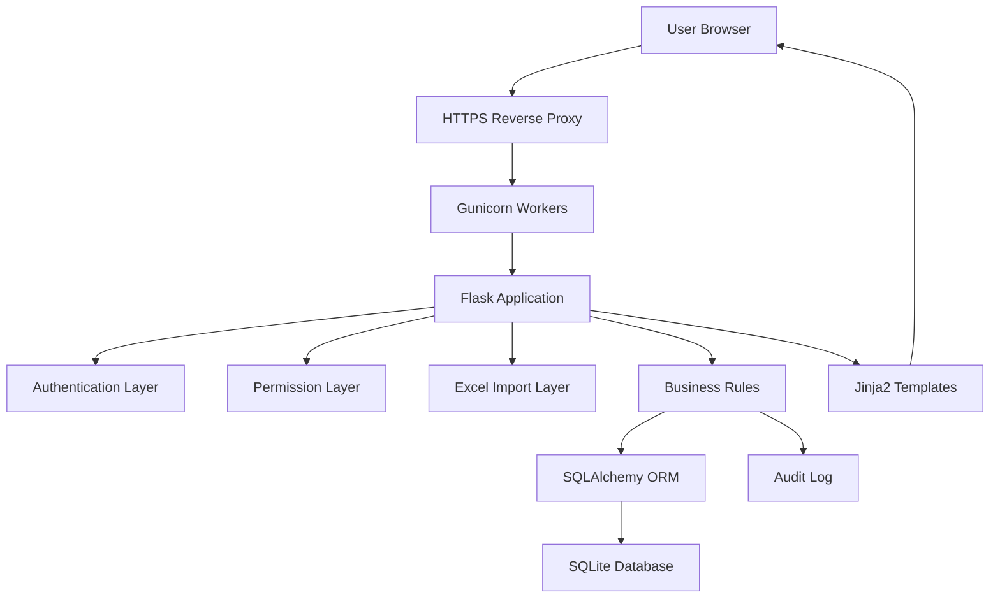
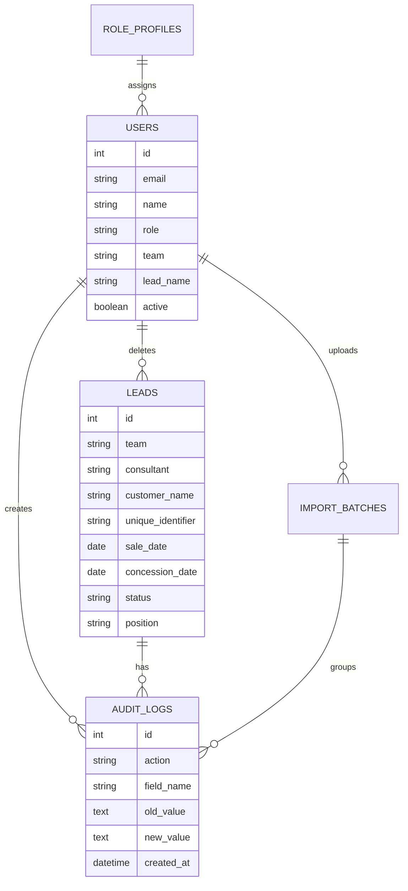

# Architecture

## Architectural Style

The CRM was designed as a **server-rendered Flask monolith**. This approach fits an internal operational system where the primary workflows are login, filtering records, editing forms, importing files and reviewing audit information.

The architecture favors:

- low infrastructure complexity;
- fast iteration;
- predictable request/response flows;
- centralized business rules;
- simple deployment in a VPS environment.

## High-Level Architecture

## Components

### Browser

Users interact with HTML pages rendered by the backend. The frontend uses Bootstrap, Jinja2 templates and a small JavaScript file for theme switching.

### Reverse Proxy

The application is intended to run behind HTTPS. The proxy terminates TLS and forwards requests to the Flask runtime.

### Gunicorn

Gunicorn runs the Flask application in production with multiple workers/threads. This provides a more appropriate runtime than Flask's development server.

### Flask Application

The Flask application contains:

- route handlers;
- authentication flow;
- permission checks;
- upload handling;
- dashboard filters;
- update workflows;
- admin screens;
- audit logging.

### SQLAlchemy ORM

SQLAlchemy models represent users, customers, configurable options, teams, role profiles, access requests, import batches and audit events.

### SQLite Database

SQLite stores the operational database. It was chosen for simplicity and cost efficiency at the project's initial scale.

### Pandas Import Layer

Pandas reads Excel files and converts spreadsheet rows into normalized customer payloads before persistence.

### Google OAuth

Google OAuth/OpenID Connect allows users to request or access the CRM with their Google account. New accounts go through an admin approval flow.

## Data Model Overview

## Communication Between Components

1. The browser submits a request.
2. Flask loads the current user from the session.
3. Security hooks validate the request.
4. The route applies business logic.
5. SQLAlchemy reads or writes database records.
6. Audit events are created for relevant changes.
7. Jinja2 renders the response.
8. The browser receives HTML.

## Authentication Architecture

The system supports two authentication modes:

- local username/e-mail and password;
- Google OAuth.

Google accounts that do not exist in the user table are not automatically granted access. Instead, an access request is created for administrative approval.

## Permission Architecture

The project uses a hybrid model:

- base roles define broad operational responsibility;
- granular permissions define field-level and feature-level access.

This avoids hardcoding all authorization behavior into only three roles and allows the business to create intermediate profiles.

## Database Architecture

SQLite is used with SQLAlchemy. The database is file-based, which keeps operations simple for a small internal system. The operational plan includes:

- backups through SQLite's backup mechanism;
- optional WAL mode for improved read/write concurrency;
- private storage location;
- no database files published to GitHub.

