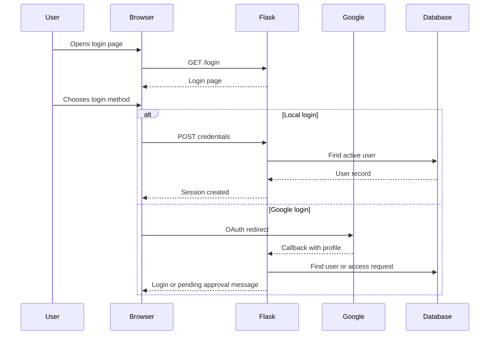
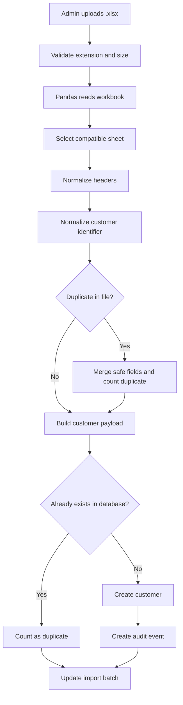
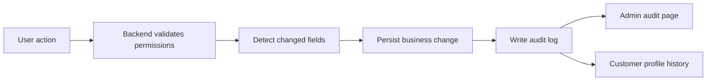
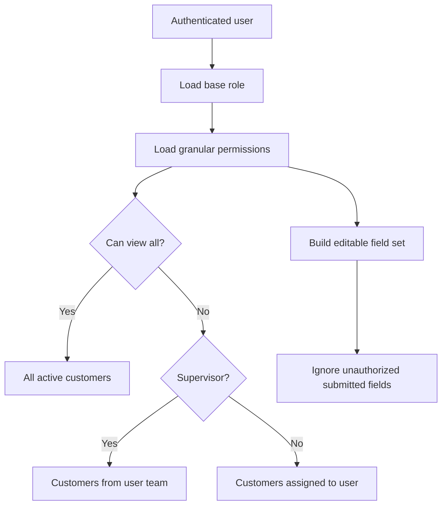

# System Flow

## Login Flow

## Dashboard Flow

1. The user accesses the dashboard.
2. The backend identifies the user's role and permissions.
3. A scoped database query is built:
   - admins can see all active customers;
   - supervisors can see their team;
   - operators can see their own assigned customers.
4. Search, status, position, date and consultant filters are applied.
5. Sorting and pagination are applied.
6. The template renders only relevant columns and actions.

## Excel Import Flow

## Audit Flow

Audit events include:

- import batches;
- customer creation;
- field updates;
- customer deletion;
- user changes;
- Google access approvals;
- configuration changes.

## Permission Flow

## Customer Update Flow

1. User opens a customer profile.
2. The template disables fields that the user cannot edit.
3. On submit, the backend recalculates allowed fields.
4. Unauthorized fields are ignored.
5. Valid option fields are checked against active configuration values.
6. Changes are persisted.
7. Each changed field is audited.

## Administration Flow

Admins can:

- approve or reject Google access requests;
- create users manually;
- assign teams and role profiles;
- configure status and position options;
- create teams;
- create role profiles;
- review imports and audit events.

