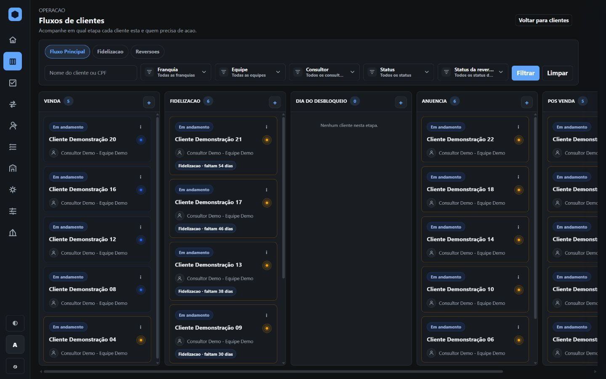
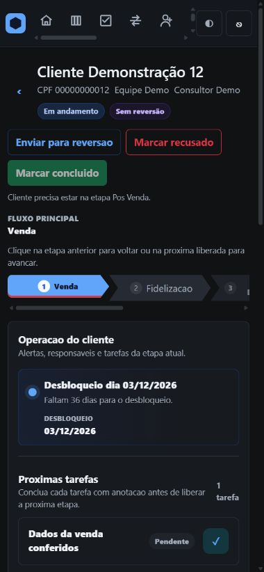
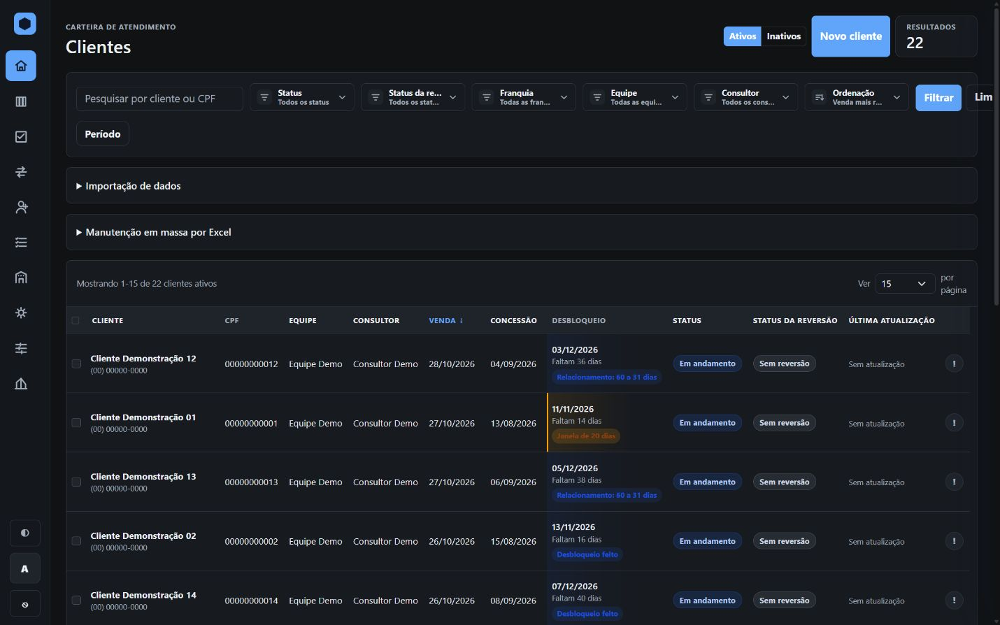

# CRM interno

Código de uma aplicação web para gestão de clientes, equipes e fluxos operacionais, preparada para demonstração pública com cadastros iniciais fictícios.

**Python · Flask · SQLAlchemy · SQLite · Pandas · Jinja2 · Bootstrap**

[Aplicação](app.py) · [Modelos](models.py) · [Testes](tests/) · [Arquitetura](ARCHITECTURE.md)

**Estado:** código público para demonstração local, com testes automatizados.



Fluxos de clientes em uma execução local. Todos os nomes, documentos, contatos e cadastros destas capturas são fictícios.

<details>
<summary>Ver no celular</summary>

Ficha de um cliente de demonstração, com etapas, alertas e tarefas.



</details>

<details>
<summary>Ver carteira de clientes</summary>



</details>

## Funcionalidades

- Login local e integração opcional com Google OAuth.
- Empresas, franquias, equipes, cargos e permissões.
- Cadastro e importação de clientes por Excel, com validação e tratamento de duplicidade.
- Carteiras, ficha de cliente, histórico de contatos e auditoria.
- Fluxos de trabalho, checklists, agenda de tarefas e fila de apoio.
- Configuração de tarefas em rascunho, revisão e publicação.
- Gestão de reversões e acompanhamento operacional.

## Executar localmente

Requisito: **Python 3.12**.

```powershell
git clone https://github.com/jovemfelpitos/internal-crm-case-study.git
cd internal-crm-case-study
py -3.12 -m venv .venv
.\.venv\Scripts\python.exe -m pip install -r requirements.txt

$env:INITIAL_LOCAL_PASSWORD = Read-Host "Escolha uma senha inicial de demonstracao (minimo 8 caracteres)"
.\.venv\Scripts\python.exe -m flask --app app init-db
.\.venv\Scripts\python.exe -m flask --app app run --host 127.0.0.1
```

Abra **http://127.0.0.1:5000**. Entre com o usuário **admin** e a senha que você escolheu. A inicialização também cria `supervisor.a`, `supervisor.b` e operadores fictícios, usando essa senha inicial. São contas de demonstração local.

O banco é criado na sua máquina em `instance/crm.sqlite3`. Ele começa **sem clientes**. Você pode cadastrar exemplos pela interface; a suíte de testes gera seus próprios clientes sintéticos em memória.

Em Linux/macOS, use `python3.12 -m venv .venv`, o executável `.venv/bin/python` e `export INITIAL_LOCAL_PASSWORD='uma-senha-escolhida-por-voce'`. A senha precisa ter pelo menos oito caracteres e não pode estar na lista de senhas comuns.

As variáveis disponíveis estão em [.env.example](.env.example), como referência; a aplicação lê os valores exportados no ambiente. Sem credenciais próprias, o login Google permanece desativado.

## Testes e verificação da publicação

```powershell
.\.venv\Scripts\python.exe -m unittest discover -s tests -p "test_*.py"
.\.venv\Scripts\python.exe tools/check_publication.py
```

Os testes usam bancos descartáveis em memória. O workflow [CI](.github/workflows/ci.yml) executa a verificação dos arquivos publicados e os testes em Python 3.12, sem acesso ao banco de produção.

## Estrutura

| Caminho | Responsabilidade |
| --- | --- |
| `app.py` | Rotas, autenticação, regras operacionais e inicialização |
| `models.py` | Modelos relacionais e permissões |
| `task_configuration*.py` | Configuração, edição e publicação de tarefas |
| `task_schedule.py` | Cálculo e simulação da agenda |
| `templates/` | Páginas Jinja2 |
| `static/` | CSS, JavaScript e Bootstrap local |
| `tests/` | Cenários integrados com exemplos fictícios |
| `tools/check_publication.py` | Verificação de arquivos operacionais e padrões de credenciais |

## O que está publicado

Esta versão contém o código da aplicação principal. Os cadastros iniciais de pessoas, equipes, empresa e domínio foram substituídos por valores fictícios. A senha inicial deve ser definida por quem instala.

Bancos, planilhas, backups, logs, capturas do ambiente real, credenciais e arquivos de implantação não fazem parte desta publicação. A prévia de compatibilidade que depende de snapshots de produção também foi excluída.

As novas imagens JPG da pasta `screenshots/` são capturas reais da aplicação executada localmente com dados sintéticos. Os arquivos SVG com sufixo `mockup` são ilustrações antigas; nenhum deles representa dados da operação.

## Documentação e limites

A documentação de estudo de caso foi preservada para explicar arquitetura e decisões. Ela descreve a base histórica do projeto; os módulos publicados incluem evoluções posteriores. Esta publicação verifica execução local e testes, sem declarar homologação para produção.

Veja [SECURITY.md](SECURITY.md) antes de configurar um ambiente real. O [LICENSE](LICENSE) existente se refere à documentação; esta publicação não adiciona uma licença de uso para o código.
