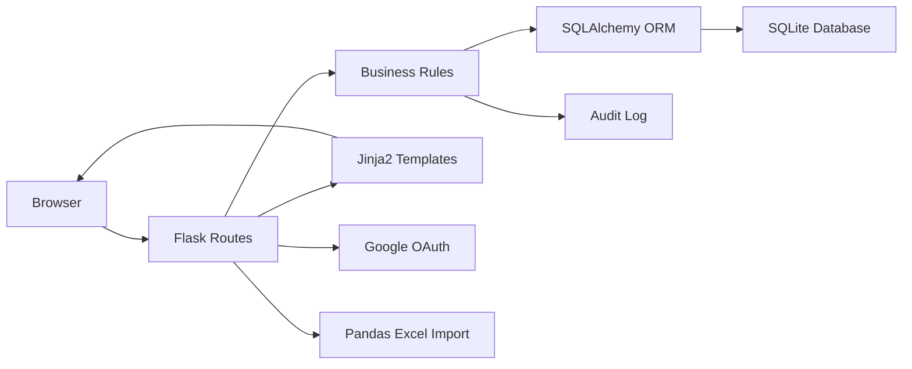

# Internal CRM Case Study

> Technical case study for an internal CRM built to support a sales and customer service operation.

This repository contains **technical documentation only**. The original source code is not included because it was developed in a corporate environment and contains proprietary implementation details.

No real customer data, credentials, database files, spreadsheets, logs, production URLs, internal e-mails, CPFs, phone numbers or confidential business rules are published here.

## Overview

The project was created to replace a spreadsheet-driven workflow with an internal web CRM. The operation needed a safer and more organized way to import customer records, assign leads to consultants, track contact history, control status updates and audit sensitive changes.

The resulting system provides a centralized interface for three operational profiles:

- **Administrators**, responsible for imports, configuration and user management.
- **Supervisors**, responsible for monitoring their own teams.
- **Operators**, responsible for updating customer contact notes and activity history.

The main goal was to turn a fragile spreadsheet process into a controlled operational system with authentication, permissions, auditability and a user experience closer to a real CRM.

## Business Problem

The previous workflow depended on shared spreadsheets. This created common operational risks:

- duplicate customer records;
- inconsistent status updates;
- lack of change history;
- difficulty separating access by team;
- manual effort to find customers;
- low visibility for supervisors;
- risk of exposing sensitive customer data to the wrong users.

The CRM was designed to reduce those risks while keeping the interface simple enough for a sales team to use every day.

## Main Features

- Local authentication.
- Google OAuth login.
- Admin approval flow for Google access requests.
- Dashboard with search, filters, sorting and pagination.
- Individual customer profile page.
- Excel import with Pandas.
- Duplicate detection by normalized customer identifier.
- Role-based and permission-based access control.
- User, role and team management.
- Configurable status and position options.
- Color-coded operational labels.
- Audit trail for imports, edits, deletions and administrative actions.
- Soft deletion for customer records.
- Light and dark theme.
- SQLite backup strategy.
- Production-oriented deployment behind HTTPS.

## Architecture Summary

The application follows a server-rendered monolithic architecture:

This architecture was intentionally chosen because the product is an internal tool with moderate traffic, strong form-based workflows and limited need for a separate frontend application.

More details are available in [ARCHITECTURE.md](ARCHITECTURE.md).

## Technology Stack

- Python
- Flask
- SQLAlchemy
- SQLite
- Pandas
- OpenPyXL
- Authlib
- Google OAuth / OpenID Connect
- Jinja2
- Bootstrap
- Gunicorn
- Linux/systemd
- Git

More details are available in [TECH_STACK.md](TECH_STACK.md).

## System Flow

At a high level:

1. A user logs in locally or with Google.
2. The backend loads the authenticated user and permissions.
3. The dashboard shows only customers the user is allowed to see.
4. Admins can import Excel files.
5. New customer records are inserted after validation and duplicate checks.
6. Users update only the fields allowed by their permissions.
7. Every relevant operation is recorded in an audit table.
8. Admins can review imports, user changes and customer activity.

More details are available in [FLOW.md](FLOW.md).

## Documentation

- [ARCHITECTURE.md](ARCHITECTURE.md): architecture, components and communication.
- [FLOW.md](FLOW.md): login, import, permissions, dashboard and audit flows.
- [TECH_STACK.md](TECH_STACK.md): technologies and rationale.
- [TECHNICAL_DECISIONS.md](TECHNICAL_DECISIONS.md): major architecture decisions.
- [CHALLENGES.md](CHALLENGES.md): main technical and product challenges.
- [RESULTS.md](RESULTS.md): outcomes and business impact.
- [SECURITY.md](SECURITY.md): publication and confidentiality notes.

## Diagrams

Mermaid diagrams are available in the [diagrams](diagrams/) folder:

- [Architecture](diagrams/architecture.mmd)
- [Login Flow](diagrams/login-flow.mmd)
- [Excel Import Flow](diagrams/import-flow.mmd)
- [Audit Flow](diagrams/audit-flow.mmd)
- [Permission Flow](diagrams/permissions-flow.mmd)

## Screenshots

The [screenshots](screenshots/) folder contains illustrative mockups using fictitious data only. They are not real production screenshots.

## Key Technical Decisions

- Use Flask instead of a heavier framework to keep delivery fast and flexible.
- Use server-side rendering because the product is workflow-heavy and form-based.
- Use SQLite to reduce infrastructure cost and operational complexity for the initial scale.
- Use SQLAlchemy to keep persistence structured and migration-ready.
- Use Pandas to import Excel files reliably.
- Use Google OAuth to reduce password friction and improve onboarding.
- Use granular permissions because roles alone were not flexible enough.
- Use audit logs to support operational accountability.

## What This Project Demonstrates

- Backend design for a real operational workflow.
- Data import and validation from spreadsheets.
- Authentication and authorization beyond simple login.
- Field-level permissions and scoped visibility.
- Auditability for sensitive business actions.
- Product thinking applied to internal tools.
- Production considerations such as HTTPS, backups and deployment simplicity.

## Future Improvements

- Add automated tests.
- Add database migrations with Alembic.
- Split the monolith into Flask blueprints and service classes.
- Add CI/CD.
- Add structured logs and monitoring.
- Add advanced audit filters.
- Add customer recovery for soft-deleted records.
- Evaluate PostgreSQL when concurrency or reporting needs grow.

## Repository Notice

This repository contains only technical documentation for the project.

The original source code is not available because it contains proprietary intellectual property developed in a corporate environment.

All diagrams and screenshots are illustrative and use fictitious information.

## License

This documentation is released under the MIT License. See [LICENSE](LICENSE).
